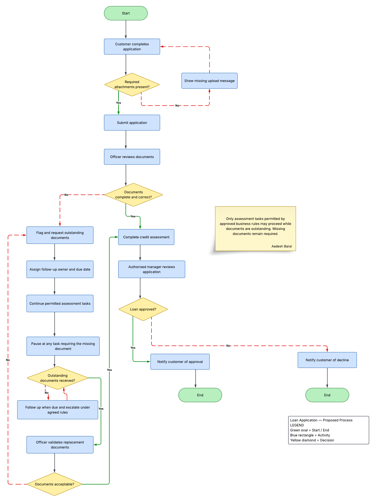

# Loan Approval Process Improvement

A business analysis practice project exploring how document validation and follow-up could improve a loan application workflow. I created a proposed process map in Lucidspark.

## Business problem

Incomplete or incorrect documents can create rework and delay assessment. This project explores earlier validation, clear follow-up responsibility, and controlled continuation of permitted assessment tasks. These are scenario assumptions to investigate, rather than findings from a real lender.

## Proposed process

1. Check that required attachments are present before submission and show a missing-upload message where needed.
2. Have an officer review document completeness and correctness.
3. Flag outstanding documents and assign a follow-up owner and due date.
4. Continue only assessment tasks permitted by approved business rules; pause tasks that depend on missing documents.
5. Follow up and escalate under agreed rules, then validate replacement documents.
6. Complete the credit assessment and route the application to an authorised manager for review.
7. Notify the customer of approval or decline.

## Process map

[View the original process map in Lucidspark](https://lucid.app/lucidspark/0acb376c-e88d-43c3-851a-b8d57038d122/edit)

Lucid sign-in and document access may be required. The PNG below can be viewed directly on GitHub.

## Business analysis skills demonstrated

- Process mapping and decision modelling
- Exception handling and document rework loops
- Follow-up ownership and escalation
- Business rules governing permitted assessment work
- Human review and customer communication

## Measures to evaluate

A real pilot could compare document completeness at first submission, document rework rate, time waiting for documents, overall application turnaround time, and overdue follow-up volume. No improvement has been measured or claimed.

## Status and next steps

This is a proposed to-be workflow for a learning scenario. Next steps are to validate the current process with stakeholders, confirm task permissions and escalation deadlines, add role swimlanes, and define requirements and acceptance criteria.

**Tool:** Lucidspark

